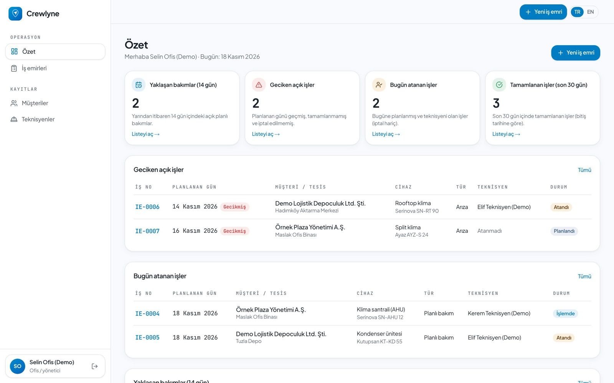
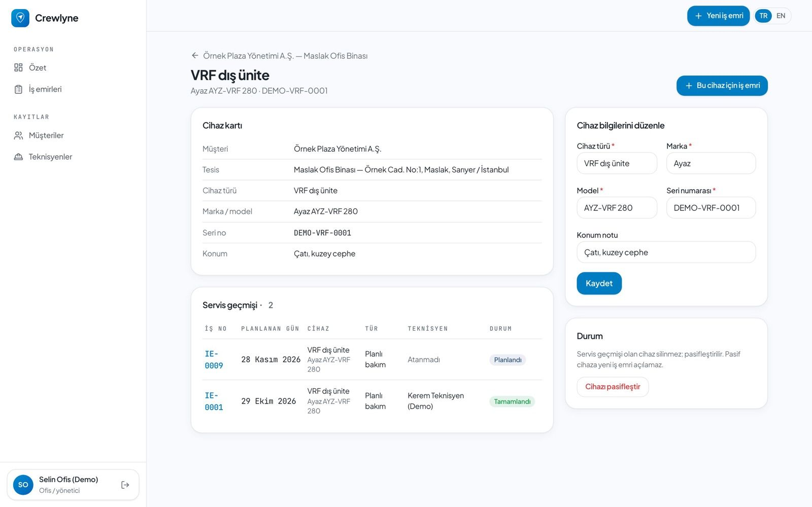
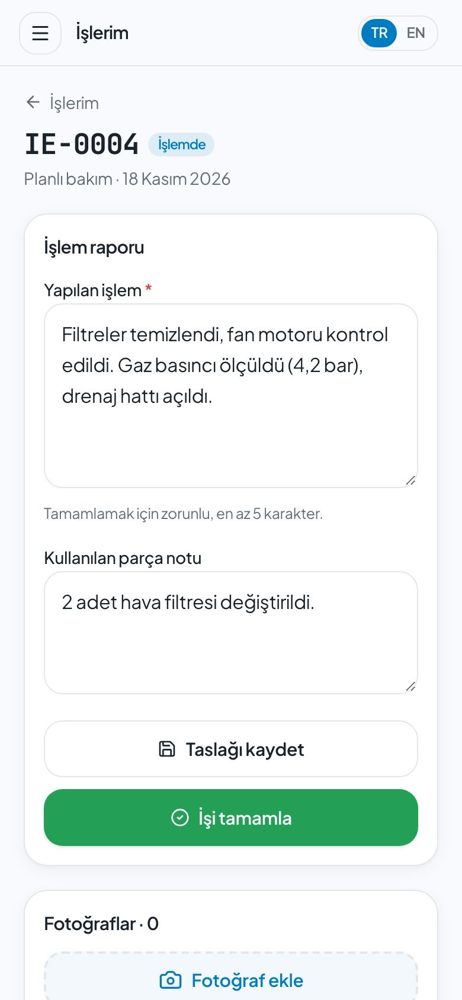

# Crewlyne

**Field service & maintenance management platform** for HVAC, industrial cooling and facility maintenance teams.

🌐 **Live:** [crewlyne.com](https://crewlyne.com)

> This repository is a public project overview. The application source code is kept private because Crewlyne is a commercial product.

---

## The problem

Small and mid-sized maintenance teams often run their operations on scattered spreadsheets, WhatsApp messages and paper service forms. Customer and device history gets lost, technicians fill in the same information twice, and service reports are slow to reach the customer.

## What Crewlyne does

**For the office**
- Create and schedule work orders, assign them to technicians
- Keep customer, site and device records with full service history
- Track job status from a single dashboard

**For field technicians (mobile-friendly)**
- See assigned jobs on the phone
- Log work done, parts used and on-site photos
- Generate a PDF service report on the spot and share it with the customer

## Screenshots

> Screens use demo data. The interface supports Turkish and English (TR / EN switch).

**Office dashboard** — overdue jobs, today's assignments and upcoming maintenance at a glance

**Work orders** — filter by status, technician, customer and date

**Device card & service history** — every visit for a device in one place

<table>
<tr>
<td width="40%" valign="top">

**Technician mobile view** — log work done and parts used, add photos, complete the job

</td>
<td width="60%" valign="top">

**PDF service report** — generated on the spot when the job is completed

</td>
</tr>
</table>

## Tech stack

| Layer | Technology |
|---|---|
| Framework | Next.js (App Router), React, TypeScript |
| Styling | Tailwind CSS |
| Data | Prisma ORM |
| Auth | Better Auth |
| Documents | React-PDF (service report generation) |
| Development | AI-assisted development with Claude Code |

## My role

I designed and built Crewlyne end-to-end: product scope, data model, user flows for office and field roles, PDF reporting and deployment — applying what I learned from years of supporting retail and field operations to a real product.

---

📫 [LinkedIn](https://www.linkedin.com/in/aykutoyekcin) · [crewlyne.com](https://crewlyne.com) · [GitHub profile](https://github.com/aoyekcin)
