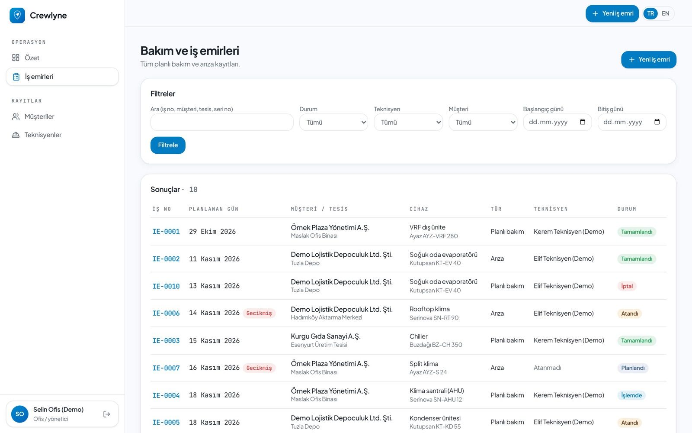
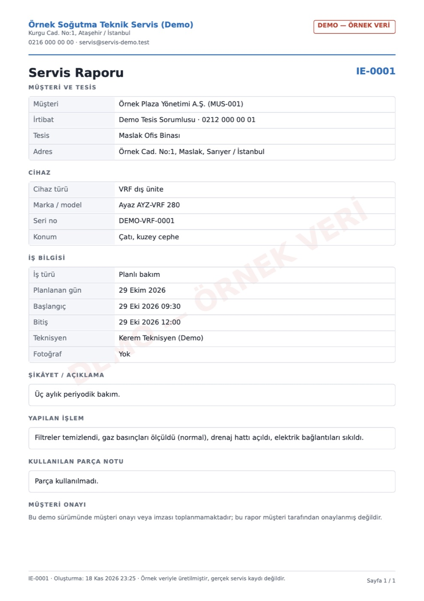

# Crewlyne

Field service and maintenance management for HVAC, industrial cooling and facility maintenance teams.

Live: [crewlyne.com](https://crewlyne.com)

> This repo is a project overview. Crewlyne is a commercial product, so the source code is private.

## The problem

A lot of small maintenance companies still run on Excel sheets, WhatsApp groups and paper service forms. Device history ends up spread across phones and folders, technicians write the same thing twice, and the customer gets the service report days later, if at all.

## What Crewlyne does

In the office:
- create work orders and assign them to technicians
- keep customers, sites and devices with their service history
- see what's open, late or done on one dashboard

In the field (works on a phone):
- see today's jobs
- write down the work done and parts used, add photos
- create the PDF service report on site and send it to the customer

## Screenshots

Demo data. The app is available in Turkish and English.

**Dashboard:** overdue jobs, today's assignments, upcoming maintenance

**Work orders:** filter by status, technician, customer and date

**Device history:** every visit for one device

<table>
<tr>
<td width="40%" valign="top">

**Technician view on mobile**

</td>
<td width="60%" valign="top">

**PDF service report** created when the job is closed

</td>
</tr>
</table>

## Tech stack

| Layer | Technology |
|---|---|
| Framework | Next.js (App Router), React, TypeScript |
| Styling | Tailwind CSS |
| Data | Prisma ORM |
| Auth | Better Auth |
| Documents | React-PDF (service report generation) |
| Development | Built with Claude Code (AI-assisted) |

## My role

I built Crewlyne on my own, from deciding what goes into the product to the data model, screens, PDF reports and deployment. Years of supporting stores and field teams helped a lot when deciding what a technician actually needs on the screen.

[LinkedIn](https://www.linkedin.com/in/aykutoyekcin) · [crewlyne.com](https://crewlyne.com) · [GitHub profile](https://github.com/aoyekcin)
